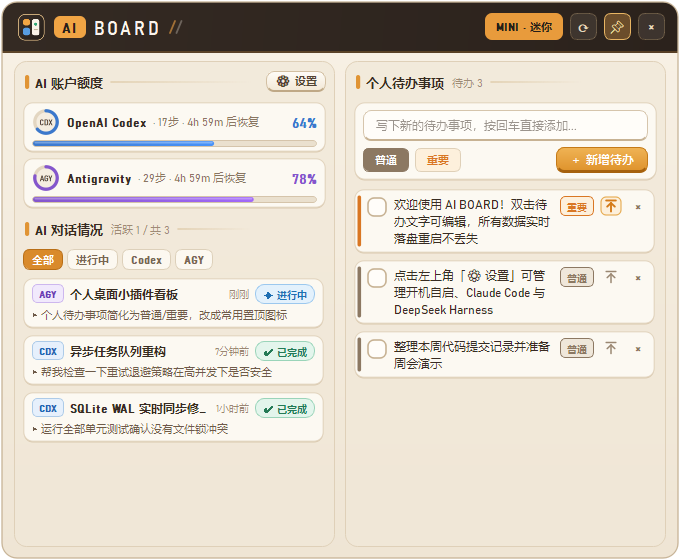

<div align="center">


# AI BOARD

**一个常驻 Windows 桌面的 AI 工作看板：AI 额度 · AI 对话进度 · 个人待办，一眼看全。**




</div>

---

## 一、介绍

如果你同时在用 Codex、Antigravity、Claude Code 这类 AI 编程工具，你大概也遇到过这些问题：额度还剩多少、什么时候恢复？哪个对话还在跑、哪个在等我确认？今天还有哪些事没做？

AI BOARD 把这三件事放进一个贴在桌面角落的小看板里，**全部数据都在本机读取和保存，不需要登录任何账号，也不上传任何内容**。

### 🔋 AI 账户额度

- 支持 **OpenAI Codex**、**Gemini Antigravity**、**Claude Code**、**DeepSeek Harness**，以及可选的 **ChatGPT 网页版**（手动记录）。
- **自动同步**：Codex 直接读取本地日志里官方的 `rate_limits`（剩余百分比 + 重置时间）；其他工具按当前窗口内的调用步数实时估算剩余额度。
- 显示**恢复倒计时**，到点自动回满；点击卡片即可手动校准百分比与周期（3h / 5h / 24h / 7 天 / 30 天）。
- 在「⚙ 设置」里可勾选显示哪些账户，并一键自动检测本机已安装的工具。

### 💬 AI 对话情况

- 自动扫描本机各工具的会话记录，实时列出所有对话。
- **主标题显示对话名称**，下方小字显示你**最近发出的一条 Prompt**。
- 自动识别状态：`进行中` / `待确认` / `已完成` / `待继续` / `异常`；可按平台或"进行中"筛选。
- 右键对话可手动改状态、置顶、改备注名或归档隐藏。
- 文件监听 + 5 秒增量扫描，AI 一回复就能看到；点 `⟳` 可强制全量刷新。

### ✅ 个人待办

- 输入后回车即可添加，支持「普通 / 重要」两档、置顶、双击编辑、勾选完成、一键清理已完成。
- 数据保存在 `%APPDATA%\AIBoard`，实时落盘 + 自动备份，**重启电脑、更新版本都不会丢**。

### 🪟 桌面常驻体验

- **双模式**：完整双栏面板 ⇄ 迷你悬浮窗（胶囊窄条  或圆形图标 ），一键切换。
- 无边框、可置顶、可拖拽和缩放，位置自动记忆；关闭后收进系统托盘继续运行。
- **开机自启**可随时开关（当前用户级，无需管理员权限）。

---

## 二、如何使用

### 1. 一键安装

在 **PowerShell** 中粘贴并运行下面这一行（无需管理员权限）：

```powershell
irm https://raw.githubusercontent.com/LazySheeeeeeep/AIBoard/main/install.ps1 | iex
```

安装脚本会自动完成：

1. 检测 Python 3.7+（没有的话会通过 `winget` 自动安装 Python 3.12）
2. 下载最新版本到 `%LOCALAPPDATA%\AIBoard`
3. 安装依赖（PyQt5）
4. 注册 `aiboard` 命令，创建桌面和开始菜单快捷方式
5. 首次安装时自动进入**配置向导**，完成后启动看板

> 如果提示"禁止运行脚本"，先执行一次：`Set-ExecutionPolicy -Scope CurrentUser RemoteSigned`

### 2. 一键配置

安装时会自动运行一次配置向导；之后想重新配置，只需在**新打开的**终端里运行：

```powershell
aiboard setup
```

向导会：

- 扫描本机的 Codex / Antigravity / Claude Code / DeepSeek Harness，**自动开启检测到的账户卡片**
- 询问是否显示 ChatGPT 网页版卡片
- 询问是否**开机自启**，以及开机后是否以迷你悬浮窗启动

想全部用推荐默认值、跳过提问：`aiboard setup --yes`

### 3. 常用命令

| 命令 | 作用 |
| --- | --- |
| `aiboard` | 启动看板（已运行时会自动唤起） |
| `aiboard setup` | 重新运行配置向导 |
| `aiboard status` | 查看开机自启状态、存档位置和各账户额度 |
| `aiboard update` | 更新到最新版本（保留所有数据和设置） |
| `aiboard uninstall` | 卸载（默认保留待办数据；加 `-Purge` 一并删除） |

### 4. 界面小提示

- **点额度卡片**：校准剩余百分比和恢复时间
- **点对话右侧的状态标签 / 右键对话**：改状态、置顶、改名、归档
- **右上角 `MINI`**：缩为迷你悬浮窗；双击悬浮窗恢复面板
- **右键托盘图标或悬浮窗**：切换形态、置顶、开机自启、退出

### 默认读取的数据目录

| 工具 | 目录 |
| --- | --- |
| OpenAI Codex | `~/.codex`（含 Microsoft Store 版本地缓存） |
| Gemini Antigravity | `~/.gemini/antigravity/brain` |
| Claude Code | `~/.claude/projects` |
| DeepSeek Harness | `$DSH_HOME` 或 `~/.dsh` |

目录不在默认位置的话，可以在「AI 账户额度 → ⚙ 设置」里手动指定。程序只读取会话日志，会主动跳过 `auth.json` 等凭证文件。

### 从源码运行（开发者）

```powershell
git clone https://github.com/LazySheeeeeeep/AIBoard.git
cd AIBoard
pip install -r requirements.txt
python app.py --setup   # 配置
python app.py           # 启动
```

---

## License

[MIT](LICENSE) © LazySheeeeeeep
